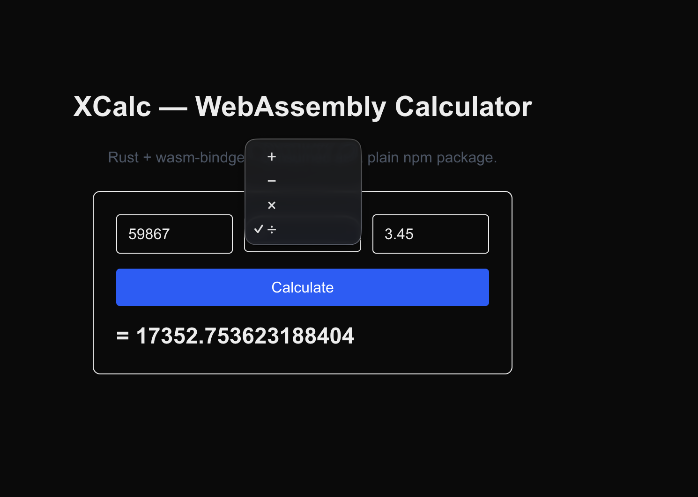

# @lagupa/xcalc

A tiny WebAssembly calculator written in Rust, compiled to WASM, and published as a plain npm package.

Demonstrates the full Rust → wasm-bindgen → wasm-pack → npm → React pipeline.

## Install

```bash
npm install @lagupa/xcalc
# or
yarn add @lagupa/xcalc
```

## Usage

```ts
import { calculate } from "@lagupa/xcalc";

calculate(5, 3, "add"); // 8
calculate(5, 3, "sub"); // 2
calculate(5, 3, "mul"); // 15
calculate(5, 3, "div"); // 1.666...
calculate(5, 0, "div"); // throws: "Division by zero"
calculate(5, 3, "wat"); // throws: "Unknown operator: wat"
```

### API

```ts
function calculate(
  a: number,
  b: number,
  op: "add" | "sub" | "mul" | "div",
): number;
```

- `a`, `b` — operands (`f64` in Rust, `number` in JS)
- `op` — one of `"add"`, `"sub"`, `"mul"`, `"div"`
- **Returns** the result as a `number`
- **Throws** a `string`-backed `Error` on division by zero or unknown operator

## Why does this exist?

It's a learning artifact. A calculator is a _terrible_ real-world use case for WebAssembly — the JS↔WASM boundary cost dwarfs the arithmetic. But it's a _great_ teaching example because it forces you through the entire toolchain with the simplest possible logic.

Use WebAssembly for the things that actually justify it: image processing, physics, parsers, crypto, SIMD-heavy math — anything that runs long enough to amortize the boundary cost.



## Source

[github.com/lagupa/xcalc](https://github.com/lagupa/xcalc)

## License

MIT
